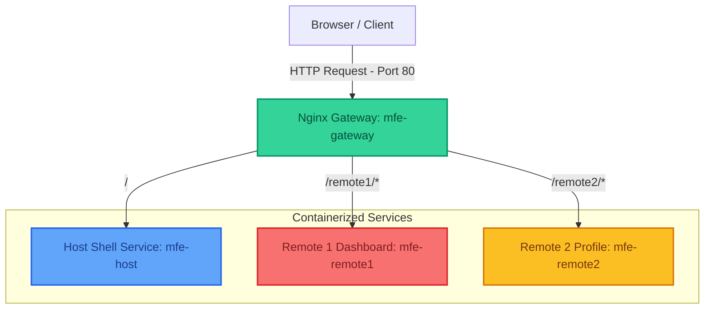
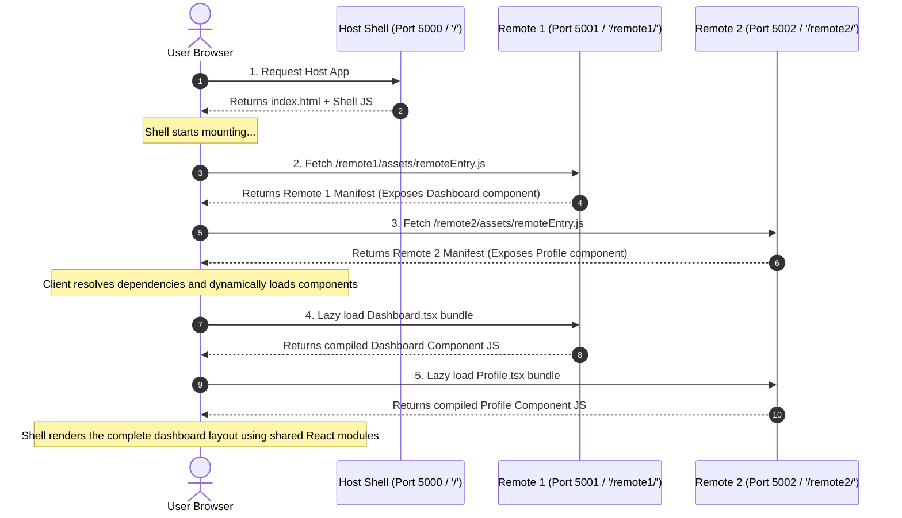
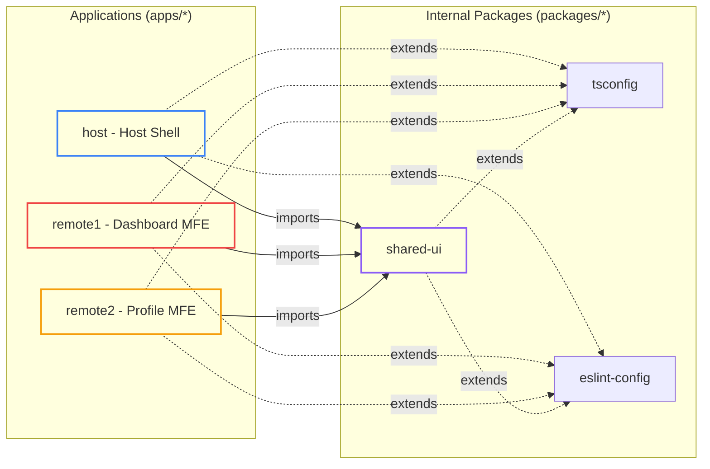

<!-- Coordinated Header -->
<div align="center">
  <br />
  <h1>Microfrontend Modular Federation Boilerplate</h1>
  
  <p>
    <a href="https://turbo.build/"></a>
    <a href="https://vitejs.dev/"></a>
    <a href="https://pnpm.io/"></a>
    <a href="https://react.dev/"></a>
    <a href="https://www.typescriptlang.org/"></a>
    <a href="https://www.docker.com/"></a>
    <a href="https://nginx.org/"></a>
  </p>
  
  <p><b>An enterprise-ready, high-performance monorepo boilerplate for scalable Micro Frontend applications</b></p>
</div>

---

## Overview

This boilerplate demonstrates enterprise-level Micro Frontend architecture using Turborepo, Vite, Module Federation, Docker, and Nginx. It is a production-grade blueprint designed for architecting scalable, loosely-coupled, and highly performant front-end systems. Built around the concept of **Microfrontends (MFEs)**, this workspace lets engineering teams build, test, and deploy features independently without breaking the global application shell.

### Core Philosophy

Monolithic frontends become slower, harder to maintain, and full of deployment friction as organization size grows. This boilerplate addresses these scaling challenges by combining:
1. **Module Federation**: Dynamic, runtime integration of code from different builds, sharing vendor dependencies (like React) seamlessly to keep bundle sizes minimal.
2. **Monorepo Architecture (Turborepo & PNPM)**: High-speed developer workflows, parallel task execution, unified configurations, and zero-overhead internal package sharing.
3. **Container-First Orchestration (Docker & Nginx)**: Simulated production topology locally using high-performance Nginx servers serving federated modules with appropriate CORS policies, combined with a unified Ingress reverse proxy.

---

## Tech Stack & Architecture Highlights

- **Workspace Engine**: [Turborepo](https://turbo.build/) & [PNPM Workspaces](https://pnpm.io/) for ultra-fast dependency caching and localized scripts.
- **Bundler & Federation**: [Vite](https://vitejs.dev/) utilizing `@originjs/vite-plugin-federation` for lightning-fast dev servers and standards-compliant ESM-based federation.
- **Frontend Framework**: [React 18](https://react.dev/) using TypeScript for reliable UI rendering.
- **Container Infrastructure**: [Docker](https://www.docker.com/) and [Nginx](https://nginx.org/) providing production-identical sandboxes with cross-origin resource sharing (CORS) rules.
- **Shared Ecosystem**: Centrally configured TSConfig, ESLint, and modular component packages.

---

## Architectural Diagrams

### 1. Ingress Request Routing (Production Topology)
When deployed via Docker, the browser requests all resources through a single gateway proxy (`mfe-gateway`) on port `80`. This architecture shields individual microfrontend server ports and resolves CORS challenges by presenting a unified domain origin:



---

### 2. Runtime Module Federation Flow
At runtime, the browser orchestrates MFE assembly. The Host App acts as a container shell, loading the remote module entries dynamically and importing exposed React components lazily inside an Error Boundary:



---

### 3. Monorepo Dependency Structure
The workspace enforces strict separation of concerns. Microfrontend applications import shared visual dependencies directly from local monorepo packages, while standardizing linting and compiler rules:



---

## Getting Started

### Prerequisites

Ensure you have the following installed locally:
- **Node.js** (v18.0.0 or higher)
- **PNPM** (v9.0.0 or higher)
- **Docker & Docker Compose** (for testing containerization)

---

### Local Development Workflow

To boot up the entire development ecosystem simultaneously with hot module reloading (HMR) across all services:

1. **Clone the repository:**
   ```bash
   git clone <repo-url>
   cd microfrontend-modular-federation-boilerplate
   ```

2. **Install all workspace dependencies:**
   ```bash
   pnpm install
   ```

3. **Start the development server:**
   ```bash
   pnpm dev
   ```

4. **Verify running environments:**
   - **Host Shell App**: [http://localhost:5000](http://localhost:5000)
   - **Remote 1 (Dashboard)**: [http://localhost:5001](http://localhost:5001)
   - **Remote 2 (Profile)**: [http://localhost:5002](http://localhost:5002)

Any changes made to files in `packages/shared-ui` will propagate to all active applications automatically.

---

### Docker Production Preview

To simulate the exact production configuration locally via Docker, Nginx, and single-domain routing:

1. **Spin up container network:**
   ```bash
   pnpm docker:up
   ```
   This will:
   - Build each application in production mode using multi-stage Docker builds.
   - Serve each application inside isolated lightweight Nginx containers.
   - Mount an Ingress Nginx gateway to route your client requests.

2. **Access the unified suite:**
   - Navigate to [http://localhost](http://localhost) (Port 80).
   - In the background:
     - Nginx acts as the single entrypoint and forwards static host calls to `mfe-host`.
     - Requesting assets or components from `/remote1/` directs traffic to `mfe-remote1`.
     - Requesting assets or components from `/remote2/` directs traffic to `mfe-remote2`.

3. **View Docker Container Logs:**
   ```bash
   pnpm docker:logs
   ```

4. **Tear down container network:**
   ```bash
   pnpm docker:down
   ```

---

## Module Federation Deep Dive

### Exposing Components (Remote Side)
Remote apps register exposed assets within their `vite.config.ts` using the federation plugin:

```typescript
// apps/remote1/vite.config.ts
import { defineConfig } from 'vite';
import react from '@vitejs/plugin-react';
import federation from '@originjs/vite-plugin-federation';

export default defineConfig({
  plugins: [
    react(),
    federation({
      name: 'remote1',
      filename: 'remoteEntry.js',
      exposes: {
        './Dashboard': './src/Dashboard.tsx' // Component exposed under an alias
      },
      shared: ['react', 'react-dom'] // Shared core React runtime
    })
  ]
});
```

### Consuming Components (Host Side)
The Host Shell application maps dynamic remotes conditionally depending on environments (dev/prod) and loads them asynchronously:

```typescript
// apps/host/vite.config.ts
export default defineConfig(({ mode }) => {
  const isProd = mode === 'production';
  return {
    plugins: [
      react(),
      federation({
        name: 'host',
        remotes: {
          remote1: isProd 
            ? '/remote1/assets/remoteEntry.js'
            : 'http://localhost:5001/assets/remoteEntry.js',
          remote2: isProd
            ? '/remote2/assets/remoteEntry.js'
            : 'http://localhost:5002/assets/remoteEntry.js',
        },
        shared: ['react', 'react-dom']
      })
    ]
  };
});
```

And lazily instantiates them in React inside an Error Boundary:

```tsx
import React, { lazy, Suspense } from 'react';

const RemoteDashboard = lazy(() => import('remote1/Dashboard'));

function App() {
  return (
    <MfeErrorBoundary fallback={<OfflineFallback />}>
      <Suspense fallback={<LoadingSpinner />}>
        <RemoteDashboard />
      </Suspense>
    </MfeErrorBoundary>
  );
}
```

---

## Robust Error Handling & Boundaries
To prevent the crash of a single remote service from breaking the global application, the host application encapsulates all remote mounts in standard React **Error Boundaries** (`MfeErrorBoundary`). If `remote1` goes offline, the rest of the application remains fully functional, presenting clean fallback designs (offline alerts) to the client.

---

## License
This project is licensed under the MIT License. See [LICENSE](LICENSE) for more details.
